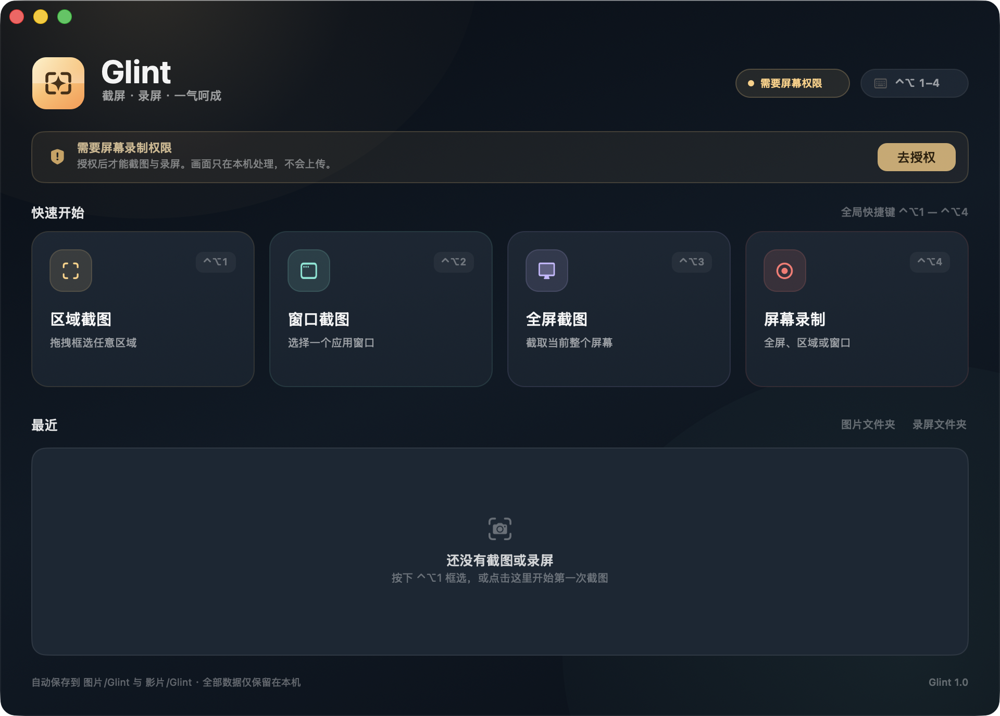
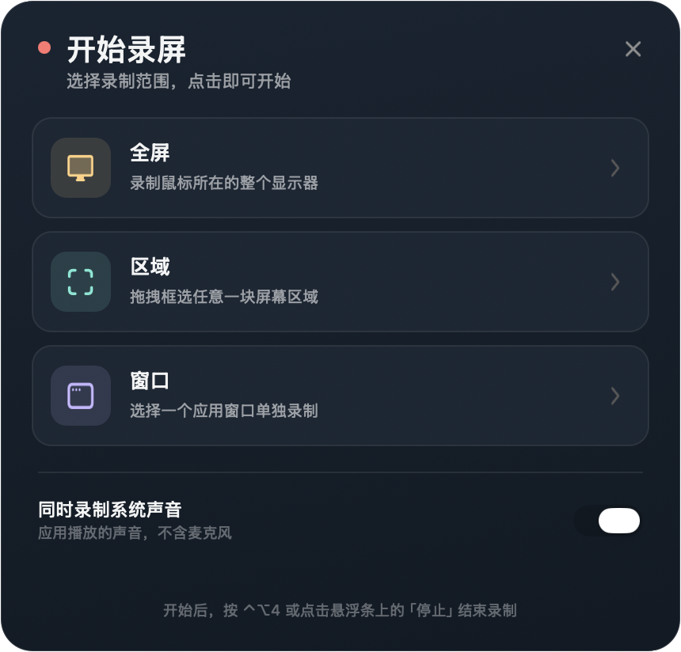

# Glint · macOS 截屏与录屏

一个原生、轻量、只用本机能力的 macOS 截屏 / 录屏工具。全局快捷键唤起，支持**区域截图、窗口截图、全屏截图、屏幕录制**，截图自动保存并复制到剪贴板，附带复制、导出、Finder 定位和视频预览。

> 深色界面 · 原生 ScreenCaptureKit · 无云端上传 · 无广告 · 无需辅助功能权限



## 功能

- **区域截图**：拖拽框选，实时显示像素尺寸，松开即截。
- **窗口截图**：缩略图选择器展示所有可见窗口，点击即截取该窗口。
- **全屏截图**：截取鼠标所在显示器，支持多显示器。
- **屏幕录制**：全屏、区域、窗口三种录制范围；H.264 MP4；可选系统声音；录制悬浮条显示计时与停止按钮。
- **结果面板**：截图自动复制到剪贴板并保存；面板内可再次复制、导出到任意位置、在 Finder 中显示；录屏结果可直接播放。
- **全局快捷键**：不依赖辅助功能（Accessibility）权限。
- **菜单栏常驻**：关闭主窗口后仍可从菜单栏或快捷键使用。
- **默认排除自身**：截图 / 录屏不会把 Glint 自己的窗口、区域选择框、录制悬浮条录进去。
- **全部本地处理**：不联网、不上传、不读取麦克风。

## 下载

从 [Releases](../../releases/latest) 下载最新的 `Glint-1.0.zip`，解压后打开 `Glint.app`。

也可以从源码构建：

```bash
git clone https://github.com/<你的用户名>/glint.git
cd glint
./build.sh
open Glint.app
```

首次截图 / 录屏前需要授予屏幕访问权限：

1. 点击主界面的「去授权」，或直接触发一次截图；
2. 在 **系统设置 → 隐私与安全性 → 屏幕与系统音频录制** 中打开 **Glint**；
3. 回到 Glint 再操作一次。如果系统仍拦截，退出 Glint 后重新打开。

> 权限与代码签名绑定。重新运行 `./build.sh` 后，macOS 可能要求重新授权一次。

## 快捷键

| 快捷键 | 功能 |
| --- | --- |
| `⌃⌥1` | 区域截图：拖拽框选 |
| `⌃⌥2` | 窗口截图：选择窗口 |
| `⌃⌥3` | 全屏截图：鼠标所在显示器 |
| `⌃⌥4` | 打开录屏设置；录制中再按一次停止 |
| `Esc` | 取消区域框选 / 关闭选择器 |

录制开始后也可以点击顶部悬浮条的「停止」，或从菜单栏选择「停止录制」。

## 使用方式

### 区域截图

按 `⌃⌥1`，屏幕变暗后拖拽选择区域。松开鼠标立即截图，图片自动保存并复制到剪贴板。框选时右上角会显示当前区域的像素尺寸。

### 窗口截图

按 `⌃⌥2` 打开窗口选择器。选择器会抓取当前所有可见窗口的缩略图，并显示应用图标、应用名和窗口标题；点击任意卡片即可截取该窗口。Glint 自己的窗口不会出现在列表里。

### 全屏截图

按 `⌃⌥3` 截取鼠标当前所在显示器。多显示器时，把鼠标移到目标屏幕再按快捷键即可。

### 屏幕录制

按 `⌃⌥4` 打开录屏设置：

- **全屏**：录制鼠标所在显示器；
- **区域**：拖拽框选录制区域；
- **窗口**：从窗口选择器中选择一个窗口。

可以打开「同时录制系统声音」。开始后顶部会出现悬浮控制条，显示录制时长和停止按钮。停止后会自动保存 MP4 并弹出视频预览面板，可直接复制文件或导出。




### 结果面板


- **复制**：截图写入 PNG + TIFF 剪贴板；视频写入文件剪贴板（可直接粘贴到聊天窗口或 Finder）。
- **导出…**：选择目标位置保存副本；视频使用标准保存面板。
- **Finder**：在 Finder 中定位原文件。
- 截图在后台自动保存，面板中的「复制」「导出」不影响原文件。

## 文件保存位置

| 类型 | 默认位置 |
| --- | --- |
| 截图 | `~/Pictures/Glint/Glint_yyyy-MM-dd_HH-mm-ss.png` |
| 录屏 | `~/Movies/Glint/Glint_Record_yyyy-MM-dd_HH-mm-ss.mp4` |

主界面的「图片文件夹」「录屏文件夹」，或者菜单栏中的同名菜单项，都可以直接打开这些文件夹。

## URL Scheme

也支持通过 URL 启动动作，方便 Shortcuts / Raycast / 脚本集成：

```bash
open "glint://area"        # 区域截图
open "glint://window"      # 窗口截图
open "glint://full"        # 全屏截图
open "glint://record"      # 打开录屏设置
open "glint://stop"        # 停止当前录制
open "glint://dashboard"   # 打开主界面
open "glint://settings"    # 请求屏幕权限
```

## 编译

只依赖 macOS Command Line Tools（无需完整 Xcode 工程）：

```bash
cd glint
./build.sh
open Glint.app
```

构建脚本使用 `swiftc` 直接编译 `Sources/*.swift`，打包 `Info.plist` 与 `.icns` 图标，并做 ad-hoc 签名。

- 系统要求：macOS 14.0+
- 已在 **macOS 26.6 / Apple Silicon** 实机验证
- 目标架构跟随 `uname -m`（当前构建为 arm64）
- 屏幕捕获依赖 ScreenCaptureKit，录制编码为 H.264 + AAC

## 实现概览

| 文件 | 作用 |
| --- | --- |
| `Sources/AppDelegate.swift` | 应用生命周期、菜单栏、截图/录屏流程编排、权限、URL Scheme |
| `Sources/Dashboard.swift` | 主界面、动作卡片、最近文件、权限提示 |
| `Sources/AreaSelector.swift` | 全屏覆盖的区域框选层、尺寸标注、暗色遮罩 |
| `Sources/WindowPicker.swift` | 窗口缩略图选择面板 |
| `Sources/CaptureEngine.swift` | ScreenCaptureKit 截图、窗口枚举与缩略图 |
| `Sources/Recorder.swift` | SCStream + AVAssetWriter 录屏、系统音频、文件封装 |
| `Sources/RecordingHUD.swift` | 录制悬浮控制条与计时 |
| `Sources/ResultPanel.swift` | 图片/视频结果面板、复制与导出 |
| `Sources/HotKeys.swift` | Carbon 全局快捷键 |
| `Sources/Models.swift` | 文件库、缩略图缓存、权限与偏好 |
| `Sources/Theme.swift` | 颜色、字体、按钮和自绘组件 |

技术要点：

- 使用 `SCScreenshotManager` 直接捕获显示器内容，不使用已废弃的 `CGWindowListCreateImage`；
- 使用 `SCContentFilter` 排除 Glint 自身窗口，避免把 UI 录进画面；
- 区域录制直接设置 `SCStreamConfiguration.sourceRect`，无需后期裁切；
- 录屏通过 `AVAssetWriter` 实时写入 H.264 MP4，音频使用 AAC；
- 图片按 2x/Retina 像素保存，并写入对应 DPI 元数据；
- 快捷键使用 Carbon `RegisterEventHotKey`，不申请辅助功能或输入监控权限。

## 已知限制

- 窗口选择器只列出**屏幕上可见**的窗口，最小化窗口不会出现。
- 录屏只支持系统声音，不采集麦克风；部分受 DRM 保护的 App 声音可能被系统屏蔽。
- 暂不包含标注、马赛克、OCR、滚动截图、暂停续录。
- App 为本地 ad-hoc 签名，未做 notarization。若从其他 Mac 拷贝，首次打开可能需要右键 →「打开」。
- 屏幕录制权限变化后，个别 macOS 版本需要重启 Glint 才能生效。

## 隐私

Glint 的所有截屏、录屏、缩略图、导出都在本机完成。没有网络请求，没有账号系统，不会上传任何画面或音频。

## 参与贡献

欢迎提交 Issue 和 Pull Request。提交前请先运行一次 `./build.sh`，确认 Command Line Tools 下能正常编译。

## 许可证

本项目采用 [MIT License](LICENSE) 开源。
