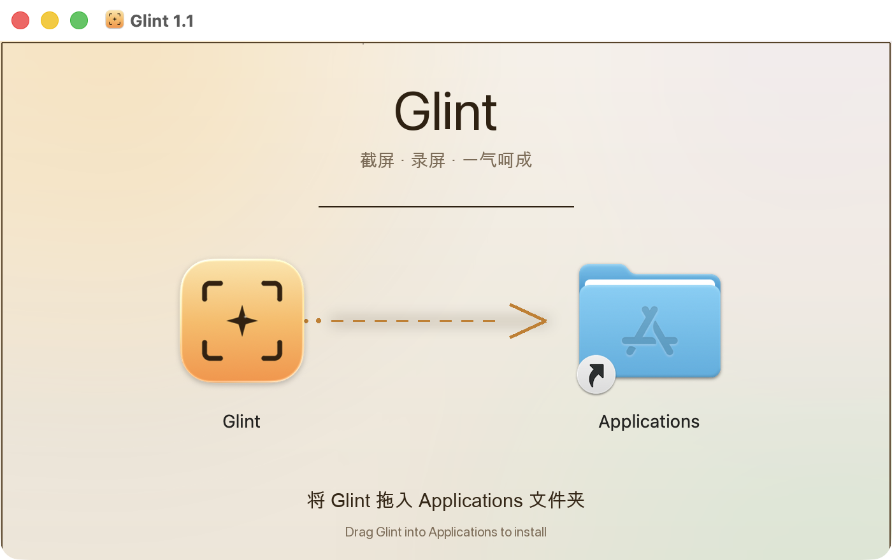
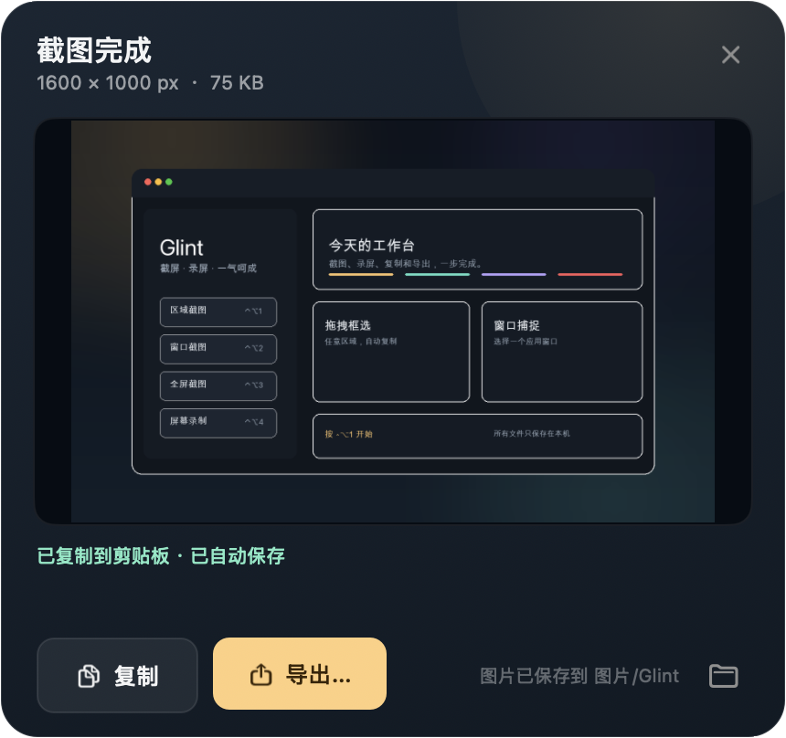
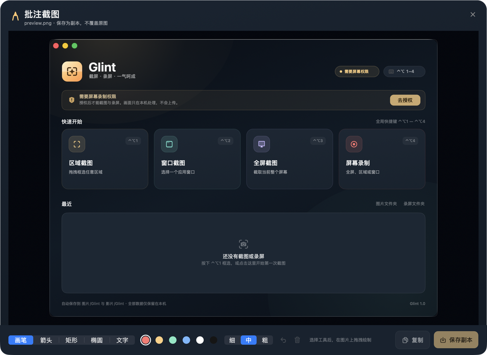
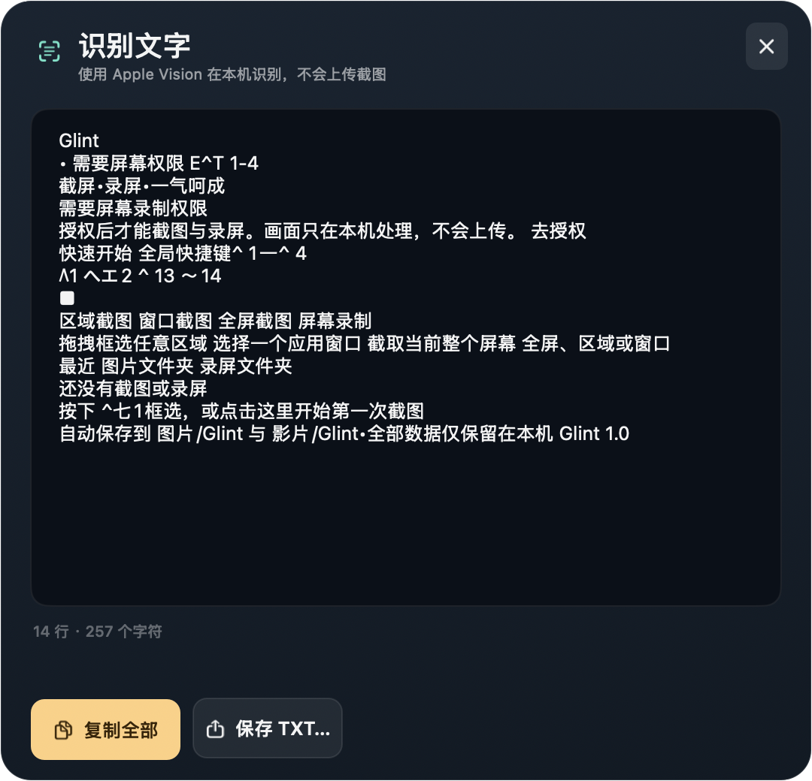
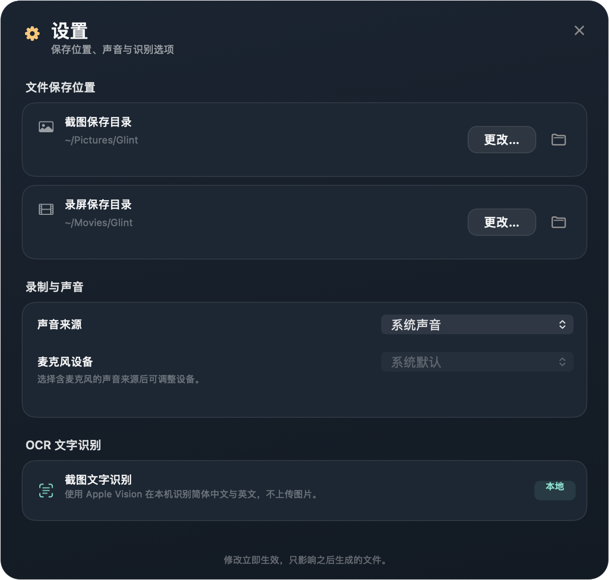

# Glint · macOS 截屏与录屏

一个原生、轻量、只用本机能力的 macOS 截屏 / 录屏工具。全局快捷键唤起，支持**区域 / 窗口 / 多显示器全屏 / 滚动截图、保存后批注（含裁剪与马赛克）、OCR 文字识别**，以及**支持暂停续录、系统声音和麦克风的屏幕录制**；还内置**多线程下载器**。截图自动保存并复制到剪贴板，附带复制、导出、Finder 定位和结果预览。

> 深色界面 · 原生 ScreenCaptureKit · Apple Vision · 无云端上传 · 无广告 · 无需辅助功能权限


## 官网

访问 **[chagan114514.github.io/glint](https://chagan114514.github.io/glint/)**：

- 自动读取 GitHub Releases，展示最新版本和历史版本；
- 每个版本提供 DMG / ZIP 直接下载；
- 支持中文 / English 切换；
- 进入下载页会提示 GitHub 海外下载速度问题，建议使用代理。

网站源码位于 [`site/`](site/)，纯 HTML / CSS / JavaScript，无第三方运行时依赖，通过 GitHub Actions 自动部署到 GitHub Pages。

## 功能

- **区域截图**：拖拽框选，实时显示像素尺寸，松开即截。
- **窗口截图**：缩略图选择器展示所有可见窗口，点击即截取该窗口。
- **全屏截图**：多显示器时先选择目标显示器，显示分辨率、Retina 和鼠标位置。
- **屏幕录制**：全屏、区域、窗口三种录制范围；H.264 MP4；支持**暂停 / 继续**、系统声音、麦克风或两者同时录制；录制悬浮条可收起为右上角迷你计时器。
- **保存后批注**：在结果面板点击「批注」，使用画笔、箭头、矩形、椭圆、文字、裁剪和马赛克；支持把图片直接拖入编辑器替换画布；保存为 `-annotated.png` 副本，不覆盖原图。
- **OCR 文字识别**：使用 Apple Vision 在本机识别简体中文和英文，结果可复制或保存为 TXT。
- **滚动截图**：框选内容区域后缓慢滚动页面，自动检测重叠并拼接成长图（最高 20,000 px）。
- **自定义保存目录**：在设置中自由更改截图和录屏目录，立即生效，只影响之后生成的文件。
- **结果面板**：截图自动复制到剪贴板并保存；面板内可再次复制、导出、OCR、批注、在 Finder 中显示；录屏结果可直接播放。
- **全局快捷键**：六项操作都可自定义，设置面板支持恢复默认；不依赖辅助功能（Accessibility）权限。
- **多线程下载器**：菜单栏「下载器…」（⌘D）下载任意 HTTP/HTTPS 文件，支持 1/2/4/8 线程、进度/速度、取消和 Finder 定位。
- **菜单栏常驻**：关闭主窗口后仍可从菜单栏或快捷键使用。
- **默认排除自身**：截图 / 录屏不会把 Glint 自己的窗口、区域选择框、录制悬浮条录进去。
- **内容完全本地**：截图、录屏、OCR、批注和导出都不上传；只有检查更新时会向更新服务器发送当前版本号，可在设置中关闭。
- **更新内容与文件判断**：更新弹窗读取 GitHub Release 说明；接口返回文件清单时，自动对比本地大小和 SHA-256，只列出需要更新的文件。

## 检查更新

启动时 Glint 会向 `https://101.37.126.79/api/glint/updates` 发送一次版本查询（仅当前版本号、平台和 build），与服务器最新版本比较。发现新版本时会提示你前往 GitHub；可以选择「稍后」或「跳过此版本」。

- 在 **设置 → 软件更新** 中可以手动检查、开启或关闭自动检查；
- 服务器返回 `patch_url` / `files` 时为增量更新，只打开必要文件包；
- 返回 `major: true` / `full: true` 时为重大更新，打开完整安装包；
- 更新服务器不可达时会回退到 GitHub 最新 Release 页面；两者都失败时自动检查静默失败，不影响截图和录屏。

完整请求/响应格式见 [`UPDATE_API.md`](UPDATE_API.md)。

## 下载

从 [Releases](../../releases/latest) 下载最新的 **Glint-1.2.0.dmg**，打开后把 **Glint** 拖进 **Applications** 文件夹即可。也提供 `Glint-1.2.0.zip` 作为免安装解压版本。



也可以从源码构建：

```bash
git clone https://github.com/Chagan114514/glint.git
cd glint
./build.sh
open Glint.app
```

首次截图 / 录屏前需要授予屏幕访问权限：

1. 点击主界面的「去授权」，或直接触发一次截图；
2. 在 **系统设置 → 隐私与安全性 → 屏幕与系统音频录制** 中打开 **Glint**；
3. 回到 Glint 再操作一次。如果系统仍拦截，退出 Glint 后重新打开。

> 权限与代码签名绑定。重新运行 `./build.sh` 后，macOS 可能要求重新授权一次。

## 快捷键

| 快捷键 | 功能 |
| --- | --- |
| `⌃⌥1` | 区域截图：拖拽框选 |
| `⌃⌥2` | 窗口截图：选择窗口 |
| `⌃⌥3` | 全屏截图：多显示器时先选择显示器 |
| `⌃⌥4` | 打开录屏设置；录制中再按一次停止 |
| `⌃⌥5` | 暂停 / 继续当前录制 |
| `⌃⌥6` | 滚动截图 |
| `Esc` | 取消区域框选 / 关闭选择器 |

以上快捷键均可在菜单栏「快捷键…」中重新绑定。

录制开始后也可以点击顶部悬浮条的「停止」，或从菜单栏选择「停止录制」。

## 使用方式

### 区域截图

按 `⌃⌥1`，屏幕变暗后拖拽选择区域。松开鼠标立即截图，图片自动保存并复制到剪贴板。框选时右上角会显示当前区域的像素尺寸。

### 窗口截图

按 `⌃⌥2` 打开窗口选择器。选择器会抓取当前所有可见窗口的缩略图，并显示应用图标、应用名和窗口标题；点击任意卡片即可截取该窗口。Glint 自己的窗口不会出现在列表里。

### 全屏截图

按 `⌃⌥3` 开始全屏截图。只有一台显示器时直接截取；多台显示器时先弹出选择器，点击目标显示器即可。

### 屏幕录制

按 `⌃⌥4` 打开录屏设置：

- **全屏**：录制鼠标所在显示器；
- **区域**：拖拽框选录制区域；
- **窗口**：从窗口选择器中选择一个窗口；
- **声音来源**：不录制、系统声音、麦克风，或系统声音 + 麦克风（两者会保存为两条音轨）。

开始后顶部会出现悬浮控制条，显示录制时长、暂停按钮、收起按钮和停止按钮。按 `⌃⌥5` 或点击「暂停」可以暂停/继续；暂停的时间不会进入最终视频。点击右侧箭头会把控制条**收起到屏幕右上角**，变成迷你计时器，点击迷你条恢复。

停止后会自动保存 MP4 并弹出视频预览面板，可直接复制文件或导出。保存时有超时保护，不会一直停留在「正在保存」。


> 麦克风录制需要 macOS 15+，首次使用会请求麦克风权限；可以在设置中选择外接麦克风设备。

### 结果面板



- **复制**：截图写入 PNG + TIFF 剪贴板；视频写入文件剪贴板（可直接粘贴到聊天窗口或 Finder）。
- **导出…**：选择目标位置保存副本；视频使用标准保存面板。
- **OCR**：识别当前截图中的文字，打开结果面板后可复制全部或保存 TXT。
- **批注**：打开标注编辑器，在截图上绘制后保存副本。
- **Finder**：在 Finder 中定位原文件。
- 截图在后台自动保存，面板中的「复制」「导出」不影响原文件。

### 保存后批注

点击结果面板中的「批注」进入编辑器：

- 工具：画笔、箭头、矩形、椭圆、文字；
- 6 种颜色、3 种线条粗细；
- 撤销（`⌘Z`）、清除全部；
- 复制批注后的图片，或保存为同目录下的 `原文件名-annotated.png`；
- **始终保存副本**，不会覆盖原图。



### OCR 文字识别

点击结果面板中的「OCR」：

- 使用 Apple Vision 在本机识别，截图不会上传；
- 默认识别简体中文和英文；
- 结果可全选、复制全部，或保存为 `.txt`。



### 滚动截图

按 `⌃⌥6` 或点击主界面的「滚动截图」：

1. 框选需要拼接的内容区域；
2. Glint 会暂时释放焦点，让页面接收滚轮；
3. 缓慢向下滚动页面，Glint 会持续捕获并检测重叠；
4. 点击顶部「完成」结束，自动拼接并保存长图。

建议框选时避开固定导航栏、固定页脚和悬浮按钮；滚动手速过快可能导致找不到重叠。最高拼接高度为 20,000 px。

## 文件保存位置

| 类型 | 默认位置 |
| --- | --- |
| 截图 | `~/Pictures/Glint/Glint_yyyy-MM-dd_HH-mm-ss.png` |
| 录屏 | `~/Movies/Glint/Glint_Record_yyyy-MM-dd_HH-mm-ss.mp4` |

可以在 **设置 → 文件保存位置** 中自由更改两个目录；修改立即生效，只影响之后生成的文件。

主界面的「图片文件夹」「录屏文件夹」，或者菜单栏中的同名菜单项，都可以直接打开当前目录。

### 设置

点击主界面右上角齿轮、菜单栏「设置…」或按 `⌘,`：

- 更改截图保存目录和录屏保存目录；
- 选择录制声音来源；
- 选择麦克风设备；
- 恢复默认保存目录。




## URL Scheme

也支持通过 URL 启动动作，方便 Shortcuts / Raycast / 脚本集成：

```bash
open "glint://area"        # 区域截图
open "glint://window"      # 窗口截图
open "glint://full"        # 全屏截图
open "glint://record"      # 打开录屏设置
open "glint://pause"       # 暂停 / 继续录制
open "glint://stop"        # 停止当前录制
open "glint://scroll"      # 滚动截图
open "glint://dashboard"   # 打开主界面
open "glint://settings"    # 打开设置
open "glint://permission"  # 请求屏幕权限
```

## 编译

只依赖 macOS Command Line Tools（无需完整 Xcode 工程）：

```bash
cd glint
./build.sh
open Glint.app
```

构建脚本使用 `swiftc` 直接编译 `Sources/*.swift`，打包 `Info.plist` 与 `.icns` 图标，并做 ad-hoc 签名。

生成带自定义背景和 Applications 快捷方式的 DMG：

```bash
./make-dmg.sh
```

首次运行会通过 pip 把 `dmgbuild` 安装到 `.build/dmg-tools`，需要网络；产物为 `Glint-1.2.0.dmg`。

- 系统要求：macOS 14.0+
- 已在 **macOS 26.6 / Apple Silicon** 实机验证
- 目标架构跟随 `uname -m`（当前构建为 arm64）
- 屏幕捕获依赖 ScreenCaptureKit，录制编码为 H.264 + AAC

## 实现概览

| 文件 | 作用 |
| --- | --- |
| `Sources/AppDelegate.swift` | 应用生命周期、菜单栏、截图/录屏流程编排、权限、URL Scheme |
| `Sources/Dashboard.swift` | 主界面、动作卡片、最近文件、权限提示 |
| `Sources/AreaSelector.swift` | 全屏覆盖的区域框选层、尺寸标注、暗色遮罩 |
| `Sources/WindowPicker.swift` | 窗口缩略图选择面板 |
| `Sources/CaptureEngine.swift` | ScreenCaptureKit 截图、窗口枚举与缩略图 |
| `Sources/Recorder.swift` | SCStream + AVAssetWriter 录屏、系统音频、文件封装 |
| `Sources/RecordingHUD.swift` | 录制悬浮控制条与计时 |
| `Sources/ResultPanel.swift` | 图片/视频结果面板、复制与导出、OCR/批注入口 |
| `Sources/SettingsWindow.swift` | 保存目录、声音来源、麦克风设备设置 |
| `Sources/OCR.swift` | Apple Vision OCR 与识别结果面板 |
| `Sources/AnnotationEditor.swift` | 归一化坐标批注画布、工具栏、全分辨率导出 |
| `Sources/ScrollingCapture.swift` | 滚动截图采集、重叠检测与长图拼接 |
| `Sources/HotKeys.swift` | Carbon 全局快捷键 |
| `Sources/Models.swift` | 文件库、缩略图缓存、权限与偏好 |
| `Sources/Theme.swift` | 颜色、字体、按钮和自绘组件 |
| `dmg_settings.py` | DMG 窗口尺寸、背景、图标位置与卷宗设置 |
| `make-dmg.sh` | 生成带品牌背景的 `Glint-1.2.0.dmg` |
| `site/` | 官网：中英文切换、GitHub Releases 自动同步、下载页速度提示 |
| `.github/workflows/pages.yml` | GitHub Pages 自动部署 |

技术要点：

- 使用 `SCScreenshotManager` 直接捕获显示器内容，不使用已废弃的 `CGWindowListCreateImage`；
- 使用 `SCContentFilter` 排除 Glint 自身窗口，避免把 UI 录进画面；
- 区域录制直接设置 `SCStreamConfiguration.sourceRect`，无需后期裁切；
- 录屏通过 `AVAssetWriter` 实时写入 H.264 MP4，音频使用 AAC；暂停通过时间戳压缩实现，暂停时段不进入成片；
- OCR 使用 `VNRecognizeTextRequest`，识别完全在本机完成；
- 滚动截图在采集帧之间做全宽抽样重叠匹配，再按重叠区域拼接；
- 批注使用归一化坐标，在任意窗口尺寸下绘制、按原图像素尺寸导出；
- 图片按 2x/Retina 像素保存，并写入对应 DPI 元数据；
- 快捷键使用 Carbon `RegisterEventHotKey`，不申请辅助功能或输入监控权限。

## 已知限制

- 窗口选择器只列出**屏幕上可见**的窗口，最小化窗口不会出现。
- 滚动截图需要手动缓慢滚动；固定页头/页脚或滚动过快可能导致重叠识别失败。
- OCR 目前固定识别简体中文 + 英文，复杂排版可能需要手动整理。
- 麦克风录制需要 macOS 15+；系统声音 + 麦克风会保存为两条音轨，部分播放器可能需要手动选择音轨。
- 部分受 DRM 保护的 App 声音可能被系统屏蔽。
- 批注始终保存为副本，不会覆盖原图；暂不包含马赛克、裁剪和旋转。
- App 为本地 ad-hoc 签名，未做 notarization。若从其他 Mac 拷贝，首次打开可能需要右键 →「打开」。
- 屏幕录制权限变化后，个别 macOS 版本需要重启 Glint 才能生效。

## 隐私

Glint 的所有截屏、录屏、OCR、批注、缩略图和导出都在本机完成。没有账号系统，不会上传任何画面或音频。唯一的网络请求是检查更新：只发送当前版本号和平台信息，可在「设置 → 软件更新」中关闭。

## 参与贡献

欢迎提交 Issue 和 Pull Request。提交前请先运行一次 `./build.sh`，确认 Command Line Tools 下能正常编译。

### 首次推送：一键配置 GitHub SSH

如果 `git push` 提示认证失败，直接双击项目根目录的 [setup-github-ssh.command](setup-github-ssh.command)，或在终端运行：

```bash
./setup-github-ssh.command
```

脚本会：

1. 检查并写入 GitHub 的 SSH 主机指纹；
2. 生成（或复用）本机 Ed25519 SSH 密钥；
3. 把公钥复制到剪贴板并打开 GitHub “New SSH key”页面；
4. 等你添加完成后验证 SSH；
5. 自动把 remote 切换为 SSH，并推送 `main` 和 tags。

也可以手动把公钥添加到 GitHub 的 **Settings → SSH and GPG keys**。

## 许可证

本项目采用 [MIT License](LICENSE) 开源。
